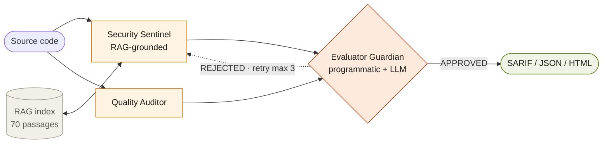

# CodeSentinel

> Multi-agent, retrieval-augmented AI code security review. **Same model, same prompts, different architecture: 97% fewer hallucinated findings.** Now a deployable, open-core product: CLI, REST API, SARIF, Docker, and Helm — air-gapped or AI-assisted.

[](.github/workflows/ci.yml)
[](./tests/)
[](./docs/API.md)
[](./LICENSE)
[](./LICENSING.md)
[](https://codesentinel-f2ggdvqeuwsj4pta5sk27s.streamlit.app)
[-d97706?style=flat-square)](./docs/CodeSentinel_Technical_Report.pdf)

CodeSentinel finds real vulnerabilities, not false alarms — and gives auditors a
citation for every one. It pairs a **deterministic rule engine** (32 rules across 7
languages, fully offline) with a **multi-agent AI pipeline** that grounds every
claim in a knowledge base and runs an adversarial reviewer over each finding before
a human sees it.

---

## Why it's different

Naive single-prompt LLM code review fails three ways: findings are **ungrounded**
(invented bugs), output is **monolithic** (nothing challenges a claim), and errors
are **untraceable**. CodeSentinel fixes all three **architecturally**:

- **Specialize** — three narrow agents (Security Sentinel · Quality Auditor ·
  Evaluator Guardian), not one model doing everything.
- **Ground** — every security claim must cite a passage from a 70-passage corpus
  (OWASP Top 10 2025 · CWE · language patterns). Uncited findings are rejected
  programmatically.
- **Adversarially validate** — a dedicated Evaluator runs programmatic + semantic
  checks on every finding and reroutes rejects upstream, bounded by a circuit
  breaker.

### The headline number

| System | TPR | FPR | False positives | CWE accuracy |
|---|---|---|---|---|
| Single-prompt baseline | 1.000 | 0.789 | **30** | 1.000 |
| Multi-agent CodeSentinel | 1.000 | 0.111 | **1** | 1.000 |
| **Δ** | 0.000 | **−0.678** | **−29 (−97%)** | 0.000 |

Real Claude Sonnet, 10-sample hand-labeled suite, same model/prompts/samples — the
97% reduction is attributable purely to the architecture. Paired suite (20 samples):
McNemar's exact **p = 0.0312**. See the [technical report](./docs/CodeSentinel_Technical_Report.pdf).

---

## Quick start

```bash
pip install "codesentinel[llm]"        # or just `codesentinel` for offline-only
codesentinel ingest                    # build the RAG knowledge base (once)

# Scan a repo, fail CI on HIGH+, emit SARIF for code scanning
codesentinel scan ./your-repo --fail-on HIGH -f sarif -o results.sarif

# No API key? Fully offline, deterministic, 7 languages:
CODESENTINEL_MOCK_LLM=1 codesentinel scan ./your-repo
```

Run it as a service:

```bash
docker compose up --build
curl -s localhost:8080/v1/scan -H "X-API-Key: $KEY" \
  -d '{"code":"cur.execute(f\"select {x}\")","language":"python"}'
```

Gate pull requests in one step (uploads to GitHub code scanning):

```yaml
- uses: AravindB98/CodeSentinel@v1
  with: { path: ., fail-on: HIGH, anthropic-api-key: ${{ secrets.ANTHROPIC_API_KEY }} }
```

---

## Capabilities

- **Two engines, one tool.** Deterministic regex rules (offline/air-gapped, no key)
  **and** the multi-agent AI pipeline (with a model). Pick per environment.
- **7 languages** out of the box: Python, JavaScript, TypeScript, Java, Go, Ruby, PHP.
- **Provenance on every finding** — CWE, OWASP 2025 mapping, a concrete fix, and the
  exact corpus passage that grounds it.
- **Outputs that fit your stack** — SARIF 2.1.0, JSON, Markdown, standalone HTML.
- **Service-ready** — FastAPI with API-key auth, tenant isolation, rate limiting,
  Prometheus metrics, structured logs, health/readiness probes.
- **Deploy anywhere** — non-root container, hardened Helm chart, GitHub Action;
  on-prem, Kubernetes, SaaS, or fully air-gapped.
- **Enterprise/Gov controls** — SSO, tamper-evident audit log, compliance packs,
  offline Ed25519 licensing, SBOM.

## Architecture



Full engineering reference: [`docs/ARCHITECTURE.md`](./docs/ARCHITECTURE.md).

## Editions

| | Community | Team | Enterprise | Government |
|---|---|---|---|---|
| AI + offline engines, SARIF, CLI, API | ✓ | ✓ | ✓ | ✓ |
| Private rule packs | — | ✓ | ✓ | ✓ |
| Multi-tenant, SSO, audit export, compliance packs | — | — | ✓ | ✓ |
| Supported air-gapped operation | — | — | Add-on | ✓ |

Free open core (Apache-2.0). Paid editions add the controls teams and governments
need at scale — see **[pricing](./docs/PRICING.md)** and **[licensing](./LICENSING.md)**.

## Documentation

| Topic | Doc |
|---|---|
| Deploy (on-prem · k8s · air-gapped · SaaS) | [docs/DEPLOYMENT.md](./docs/DEPLOYMENT.md) |
| Administration & configuration | [docs/ADMIN.md](./docs/ADMIN.md) |
| REST API reference | [docs/API.md](./docs/API.md) |
| Editions & pricing | [docs/PRICING.md](./docs/PRICING.md) |
| Compliance (NIST · SOC 2 · ISO · FedRAMP · CRA) | [docs/COMPLIANCE.md](./docs/COMPLIANCE.md) |
| Threat model | [docs/THREAT_MODEL.md](./docs/THREAT_MODEL.md) |
| Security policy | [SECURITY.md](./SECURITY.md) |
| Solution brief (for buyers) | [docs/SOLUTION_BRIEF.md](./docs/SOLUTION_BRIEF.md) |
| Architecture | [docs/ARCHITECTURE.md](./docs/ARCHITECTURE.md) |

## Repository structure

```
codesentinel/            # installable package
├── engine.py            #   multi-file scanner (deterministic + LLM backends)
├── cli.py               #   scan / serve / rules / baseline / sbom / license
├── config.py            #   .codesentinel.yml + env + overrides
├── rules.py             #   32-rule registry across 7 languages
├── models.py            #   normalized Finding / ScanResult contract
├── editions.py          #   Ed25519 offline licensing + feature gating
├── audit.py             #   hash-chained tamper-evident audit log
├── observability.py     #   Prometheus metrics + structured logging
├── sbom.py              #   CycloneDX 1.5 SBOM
├── reporters/           #   SARIF 2.1.0 · JSON · Markdown · HTML
├── api/                 #   FastAPI service + auth
├── graph/               #   LangGraph multi-agent pipeline + prompts
├── rag/                 #   retrieval (ChromaDB → TF-IDF → pure-python)
├── rl/ · synth/ · utils/
deploy/helm/             # Kubernetes chart
.github/workflows/       # CI, CodeQL, self-scan, release, pages
eval/                    # reproducible benchmark harness + results
tests/                   # 35 unit tests (pass with or without optional deps)
Dockerfile · docker-compose.yml · action.yml · Makefile · pyproject.toml
```

## Reproduce the benchmark

```bash
make benchmark                         # deterministic mock-mode, no key
ANTHROPIC_API_KEY=sk-ant-... make benchmark   # real Claude Sonnet (~$2 toy suite)
```

## From research to product

CodeSentinel began as research under **Prof. Nik Bear Brown** at Northeastern
University (INFO 7375, Spring 2026). The architectural pattern — *specialize, ground,
adversarially validate* — mirrors the approach industrial-scale AI security systems
use to find zero-days; this project demonstrates it is reproducible, testable, and
now **productized** with open tools. **Author:** Aravind Balaji ·
balaji.ara@northeastern.edu.

## License

Open core under **Apache-2.0** (see [LICENSE](./LICENSE)). Enterprise/Government
features are commercially licensed (see [LICENSING.md](./LICENSING.md)).
