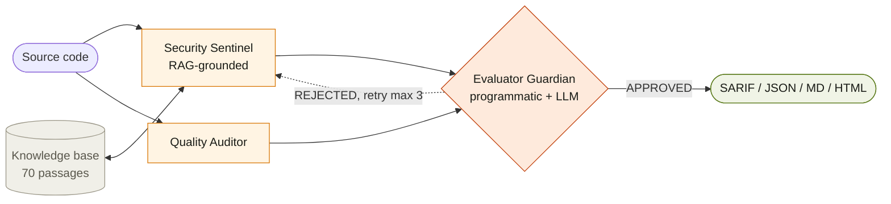
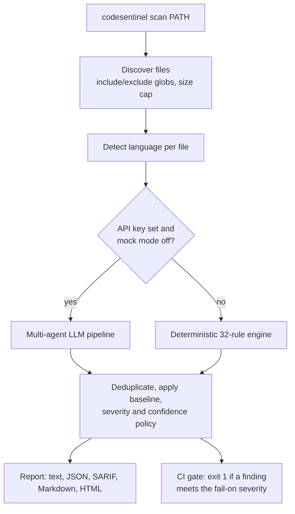

# CodeSentinel v2

> AI code security review that refuses to hallucinate. Three specialized agents, a cited knowledge base, and an adversarial reviewer that rejects any finding it cannot prove. **Same model, same prompts, different architecture: 97% fewer false positives.** v2 turns the original research prototype into a deployable, open-core product: CLI, REST API, SARIF, Docker, Helm, and a fully offline rule engine.

[](https://aravindb98.github.io/CodeSentinel-v2/)
[](https://codesentinel-f2ggdvqeuwsj4pta5sk27s.streamlit.app)
[-c2410c?style=flat-square&logo=youtube)](https://youtu.be/do8GvAK7tHI)
[-d97706?style=flat-square)](./docs/CodeSentinel_Technical_Report.pdf)
[](./tests/)
[](./docs/API.md)
[](./LICENSE)
[](./LICENSING.md)

**Author:** Aravind Balaji · M.S. Information Systems · Northeastern University · balaji.ara@northeastern.edu

---

## Contents

1. [Explain it like I'm five](#explain-it-like-im-five)
2. [What is CodeSentinel](#what-is-codesentinel)
3. [CodeSentinel v1 vs v2](#codesentinel-v1-vs-v2)
4. [The headline number](#the-headline-number)
5. [How it works](#how-it-works)
6. [Quick start](#quick-start)
7. [Using the CLI](#using-the-cli)
8. [Running it as a service](#running-it-as-a-service)
9. [CI/CD integration](#cicd-integration)
10. [Configuration](#configuration)
11. [Detection coverage](#detection-coverage)
12. [Editions and licensing](#editions-and-licensing)
13. [Reproduce the benchmark](#reproduce-the-benchmark)
14. [Repository structure](#repository-structure)
15. [Honest limitations](#honest-limitations)
16. [Documentation and links](#documentation-and-links)
17. [Credits and license](#credits-and-license)

---

## Explain it like I'm five

Imagine you built a giant LEGO castle, and you want to know if any part of it is wobbly before your little brother runs into it.

**The old way (one AI, one prompt).** You ask one friend to look at the castle. This friend really wants to be helpful, so he points at lots of things and says "that's broken!" even when it isn't. Out of every 31 things he points at, 30 are fine. After a while you stop listening to him, and then you miss the one wobbly piece that mattered.

**The CodeSentinel way.** You ask three friends, and each one has exactly one job:

- **The Detective** (Security Sentinel) looks for wobbly pieces. But there is a rule: every time she says "this is wobbly," she has to open the big LEGO rule book and point to the page that says why. No page, no complaint.
- **The Tidy Friend** (Quality Auditor) does not look for danger. He looks for mess: pieces that are confusing or hard to fix later.
- **The Judge** (Evaluator Guardian) does not look at the castle at all. She only checks the Detective's work. "Show me the page. Does that page really say this? Did you explain how to fix it?" If the answer is no, she sends the Detective back to try again. After three tries she says "enough" and the complaint is thrown away.

Only the complaints the Judge agrees with reach you. So when CodeSentinel says "this piece is wobbly," it is almost always true, and it comes with the page from the rule book and instructions to fix it.

**And what is v2?** Version 1 was a science fair project: it proved the three-friends idea works. Version 2 packs those friends into a toolbox anyone can carry to their own castle. It also adds a fourth helper, a checklist robot that knows 32 common mistakes by heart and needs no internet at all, so it can work even inside a locked room.

| In the story | In the real system |
|---|---|
| LEGO castle | Your source code |
| Wobbly piece | A security vulnerability (SQL injection, unsafe deserialization, and so on) |
| The rule book | A 70-passage knowledge base built from OWASP Top 10 2025, CWE, and language patterns |
| Pointing to the page | A citation attached to every finding (RAG grounding) |
| The Judge sending work back | The Evaluator Guardian's reject and retry loop, capped at 3 retries |
| The checklist robot | The deterministic 32-rule offline engine added in v2 |

---

## What is CodeSentinel

CodeSentinel is a code security review system. You point it at a file or a repository and it reports vulnerabilities, each with a CWE identifier, an OWASP Top 10 2025 category, a severity, a confidence score, a concrete fix, and the exact knowledge base passage that justifies the claim.

It exists because a single prompt to an LLM is a poor code reviewer in three specific ways:

| Failure of single-prompt review | What it looks like | How CodeSentinel closes it |
|---|---|---|
| **Ungrounded findings** | The model invents plausible vulnerabilities that are not in the code | **Ground:** every security claim must cite a retrieved passage. Findings without a valid citation are rejected in code, not by asking the model nicely |
| **Monolithic output** | Nothing challenges a claim, so false positives pass through as easily as true ones | **Adversarially validate:** a separate Evaluator agent audits every finding and can send it back |
| **Untraceable errors** | No record of what the model knew or why it concluded something | **Specialize and record:** narrow agents with typed inputs and outputs, explicit graph state, and provenance on each finding |

The design principle is *specialize, ground, adversarially validate*. The gain comes from the architecture, not from a cleverer prompt, which means it carries over when the underlying model is swapped for a stronger one.

---

## CodeSentinel v1 vs v2

Both versions share the same core idea and the same three-agent pipeline. The difference is what surrounds it.

- **v1** is the research prototype, built for INFO 7375 (Prompt Engineering and Generative AI) at Northeastern University in Spring 2026 under Prof. Nik Bear Brown. Its job was to answer a research question: does a multi-agent, citation-enforced architecture reduce hallucinated findings compared with a single prompt? It answered yes, with a measured 97% reduction. It reviews one code snippet at a time through a Streamlit page or a benchmark script.
- **v2** is the product built on top of that result (June 2026). Its job is to be something a security team can install, run on a real repository, wire into CI, and deploy on their own infrastructure, including networks with no internet access.

> **A note on version numbers.** "v2" is the generation of the project. The installable package inside this repository is versioned **1.0.0** because it is the first production release, so `codesentinel version` prints `CodeSentinel 1.0.0`. Separately, `docs/ARCHITECTURE.md` uses "v1" and "v2" for two revisions of the technical report. In this README, v1 always means the research prototype and v2 always means this repository.

### Side by side

| | **v1: research prototype** | **v2: this repository** |
|---|---|---|
| Purpose | Prove the architecture reduces hallucinations | Ship that architecture as a usable product |
| Date | April 2026 | June 2026 (package 1.0.0) |
| How you use it | `make benchmark`, Streamlit UI | `codesentinel` CLI, REST API, GitHub Action, Docker, Helm, Streamlit UI |
| What it reviews | One pasted snippet at a time | Whole files and repositories: file discovery, include/exclude globs, size caps, parallel workers, deduplication |
| Detection engines | Multi-agent LLM pipeline only (plus a mock LLM for tests) | Two engines: the multi-agent LLM pipeline **and** a deterministic 32-rule engine that runs fully offline |
| Languages | Python, JavaScript, Java | Python, JavaScript, TypeScript, Java, Go, Ruby, PHP |
| Knowledge base | 56 passages | 70 passages (OWASP Top 10 2025, CWE subset, language patterns) |
| Output | Console text and benchmark summaries | SARIF 2.1.0, JSON, Markdown, standalone HTML, colored terminal text |
| CI gating | None | `--fail-on` severity gate with exit codes, baseline files to suppress pre-existing findings |
| Configuration | Environment variables | `.codesentinel.yml`, environment variables, and CLI overrides |
| Service mode | None | FastAPI service with API-key auth, tenant isolation, rate limiting, security headers, body-size limits, health and readiness probes |
| Observability | Logs | Prometheus metrics, structured JSON logs, tamper-evident hash-chained audit log |
| Supply chain | None | CycloneDX 1.5 SBOM generation, CodeQL, Dependabot, self-scan workflow |
| Deployment | Clone and run locally | Non-root multi-stage Docker image, Docker Compose, hardened Helm chart, air-gapped operation |
| Code layout | Top-level `graph/`, `rag/`, `rl/`, `synth/`, `utils/` folders | One installable `codesentinel` package with optional extras (`llm`, `rag`, `graph`, `api`, `ui`) |
| Size | About 5,000 lines of Python | About 7,900 lines of Python |
| Tests | 35 | 67 (pass with or without the optional dependencies) |
| License | MIT | Open core: Apache-2.0 core (adds a patent grant) plus a commercial license for Enterprise and Government features, enforced by offline Ed25519 license keys |
| Documentation | README, architecture doc, 46-page technical report | All of v1's, plus deployment, admin, API, compliance mapping, threat model, security policy, pricing, and solution brief |

### What stayed the same

The research core is untouched, on purpose. v2 still has the same three agents, the same prompts, the same citation-required policy, the same retry loop with a circuit breaker, and the same benchmark harness and committed results. The 97% figure was measured on the v1 pipeline in April 2026 and was not re-run for v2. In mock mode the v2 benchmark reproduces the v1 behavior exactly.

### Bugs v2 fixed along the way

- **Schema validation was silently skipped.** The contract checks on findings (fix text at least 20 characters, confidence between 0 and 1, ID formats) only ran in a dataclass fallback path. When pydantic, the real dependency, was installed, they did not run at all. v2 routes them through a pydantic validator so they fire in both modes.
- **Clean files cost three times too much.** The Evaluator used to force up to two extra Security Sentinel retries on files with no findings. v2 removes that, cutting cost on clean inputs by roughly 3x with no change to benchmark results.

### Which one should you use?

Use **v2**. It contains everything v1 does. Go back to the v1 snapshot only if you want to read the course submission exactly as it was graded; it lives at [AravindB98/CodeSentinel](https://github.com/AravindB98/CodeSentinel) and in this repository's early git history.

---

## The headline number

| System | TPR | FPR | False positives | CWE accuracy |
|---|---|---|---|---|
| Single-prompt baseline | 1.000 | 0.789 | **30** | 1.000 |
| Multi-agent CodeSentinel | 1.000 | 0.111 | **1** | 1.000 |
| **Change** | 0.000 | **-0.678** | **-29 (-97%)** | 0.000 |

How to read this: both systems found every real vulnerability (TPR 1.000). The single prompt also reported 30 that did not exist. CodeSentinel reported 1.

- **Setup:** real Claude Sonnet, 10 hand-labeled samples, April 20, 2026. Same model, same prompts, same samples for both systems, so the difference is attributable to the architecture. Raw output is in [`eval/results/20260420_143220/`](./eval/results/20260420_143220/).
- **Second suite:** on a 20-sample paired suite in the style of the OWASP Benchmark, the multi-agent pipeline reached TPR 1.000 against the baseline's 0.333, with FPR 0.182 against 0.571. McNemar's exact test gives **p = 0.0312** (significant at 0.05). Youden index: +0.818 against -0.238.
- **Semgrep comparison:** a comparison against Semgrep on Flask's production source, with manual adjudication, is in [`eval/results/semgrep_comparison/`](./eval/results/semgrep_comparison/).

These are small suites. See [Honest limitations](#honest-limitations).

---

## How it works

### The multi-agent pipeline (AI mode)



Step by step, for one file:

1. **Retrieve.** The code is used to query the knowledge base. The top 6 passages come back (configurable as `retrieval_k`). Retrieval has three backends and falls through them automatically: ChromaDB with sentence-transformer embeddings, then a scikit-learn TF-IDF index, then a pure-Python scorer with no dependencies.
2. **Security Sentinel.** An LLM agent with one job: find vulnerabilities, and for each one cite a passage ID from the retrieved set, name the CWE, give a confidence, and write a concrete fix.
3. **Quality Auditor.** A second agent reviews maintainability and style. It runs independently and never makes security claims.
4. **Evaluator Guardian.** Every finding goes through two layers:
   - **Programmatic checks.** Is a citation present, and is it one of the passages that was actually retrieved? Is the fix at least 20 characters? Is confidence at least 0.5? Does the finding match the schema? These are plain code, so the model cannot talk its way past them.
   - **Semantic check.** An LLM call asks whether the cited passage really supports the claim.
5. **Route.** Approved findings go to the report. Rejected findings go back to the Security Sentinel with structured feedback. A circuit breaker stops the loop after 3 retries so it cannot run forever or run up cost.

The pipeline is orchestrated with LangGraph using explicit typed state. If LangGraph is not installed, an equivalent built-in runner executes the same graph.

A story worth knowing: during development the Evaluator rejected a *correct* finding on a `hashlib.md5` sample, because the mock model cited a passage the retriever had not returned. The system caught a bug in its own test fixture. The fix was to correct the citation, not to relax the rule. Details are in section 11.6 of the technical report.

### The deterministic engine (offline mode, new in v2)

When there is no API key, or when you force offline mode, CodeSentinel uses a registry of 32 regex-based rules. Each rule maps to a CWE, an OWASP category, a severity, a fix, and a knowledge base passage, so offline findings carry the same provenance as AI findings. Nothing leaves the machine. Results are identical on every run, which is what makes it suitable for CI and air-gapped networks.

### How the scanning engine chooses



The choice can be pinned with `engine: auto | deterministic | llm` in `.codesentinel.yml`.

---

## Quick start

> **Install from this repository, not from PyPI.** The name `codesentinel` on PyPI belongs to an unrelated project, so `pip install codesentinel` would install something else.

**Offline, no API key (about one minute):**

```bash
git clone https://github.com/AravindB98/CodeSentinel-v2.git
cd CodeSentinel-v2
pip install -e .

codesentinel scan ./your-repo --mock
```

**Full AI review:**

```bash
pip install -e ".[llm,rag,graph]"
export ANTHROPIC_API_KEY=sk-ant-...
codesentinel ingest                  # build the knowledge base index (once)
codesentinel scan ./your-repo
```

**Everything, including API server, UI, and dev tools:**

```bash
pip install -e ".[all,dev]"
make test                            # 67 tests
```

Requires Python 3.10 or newer. The core install is deliberately small (pydantic, PyYAML, NumPy); heavier capabilities sit behind extras:

| Extra | Adds |
|---|---|
| `llm` | Anthropic SDK for real-model review |
| `rag` | ChromaDB, sentence-transformers, scikit-learn for semantic retrieval |
| `graph` | LangGraph orchestration |
| `api` | FastAPI and Uvicorn for the REST service |
| `ui` | Streamlit demo app |
| `dev` | pytest, ruff, mypy |
| `all` | `llm`, `rag`, `graph`, `api`, `ui` |

### What the output looks like

```text
$ codesentinel scan demo.py --mock
CodeSentinel 1.0.0 (community edition) - target: demo.py

CRITICAL CWE-89     demo.py:3
  SQL Injection: CWE-89 (A03:2025 Injection)
  > cur.execute(f"select * from t where id={x}")
  fix: Use parameterized queries with placeholders instead of f-strings.
  provenance: patterns.md::PY-01 | confidence 0.94

CRITICAL CWE-502    demo.py:5
  Insecure Deserialization: CWE-502 (A08:2025 Software and Data Integrity Failures)
  > return pickle.loads(x)
  fix: Never unpickle untrusted data. Use json.loads() with schema validation.
  provenance: patterns.md::PY-02 | confidence 0.96

HIGH     CWE-78     demo.py:4
  Command Injection: CWE-78 (A03:2025 Injection)
  > os.system("ls "+x)
  fix: Avoid os.system; use subprocess.run([...]) with a list of arguments.
  provenance: patterns.md::PY-03 | confidence 0.84

Summary: 3 finding(s) [crit 2 · high 1 · med 0 · low 0 · info 0] across 1 file(s)
```

The `provenance` line is the citation: the knowledge base passage that grounds the finding.

---

## Using the CLI

The command is `codesentinel`, with `cs` as a short alias.

| Command | What it does |
|---|---|
| `codesentinel scan PATH` | Scan a file or directory |
| `codesentinel baseline PATH` | Snapshot current findings so only new ones fail CI |
| `codesentinel rules` | List the detection rules (`--json` for machine output) |
| `codesentinel ingest` | Build or rebuild the knowledge base index |
| `codesentinel serve` | Run the REST API |
| `codesentinel sbom` | Emit a CycloneDX SBOM for the install |
| `codesentinel license info` | Show the active edition and license |
| `codesentinel version` | Print version and edition |

Useful `scan` options:

| Option | Meaning |
|---|---|
| `-f text\|json\|sarif\|markdown\|html` | Report format (default `text`) |
| `-o FILE` | Write the report to a file |
| `--fail-on SEVERITY` | Exit 1 if any finding is at or above this severity |
| `--severity-threshold SEVERITY` | Minimum severity to report |
| `--baseline FILE` | Suppress findings recorded in a baseline |
| `--mock` | Force the deterministic offline engine |
| `--no-quality` | Security findings only, skip the Quality Auditor |
| `--concurrency N` | Parallel file workers |
| `-c FILE` | Path to a `.codesentinel.yml` |

Common recipes:

```bash
# Gate a build on HIGH or worse, write SARIF for code scanning
codesentinel scan . --fail-on HIGH -f sarif -o results.sarif

# Adopt on a legacy codebase: accept today's findings, fail only on new ones
codesentinel baseline . -o .codesentinel-baseline.json
codesentinel scan . --baseline .codesentinel-baseline.json --fail-on HIGH

# A shareable HTML report
codesentinel scan . -f html -o report.html
```

Baselines store line-independent fingerprints (rule, file, normalized snippet), so moving code around does not resurrect old findings.

---

## Running it as a service

```bash
cp .env.example .env                 # set CODESENTINEL_API_KEYS=tenant:secret
docker compose up --build

curl -s localhost:8080/v1/scan \
  -H "X-API-Key: $KEY" -H "Content-Type: application/json" \
  -d '{"code":"cur.execute(f\"select {x}\")","language":"python"}'
```

Or without Docker: `pip install -e ".[api]"` then `codesentinel serve`.

| Endpoint | Purpose |
|---|---|
| `POST /v1/scan` | Scan submitted code |
| `GET /v1/scans`, `GET /v1/scans/{id}` | List and fetch past scans (scoped to the calling tenant) |
| `GET /v1/rules` | The rule registry |
| `GET /v1/audit` | Audit log access |
| `GET /healthz`, `GET /readyz` | Liveness and readiness probes |
| `GET /metrics` | Prometheus metrics |
| `GET /version` | Version and edition |

API keys take the form `tenant:secret`, and each tenant only sees its own scans. The service applies rate limiting, security headers, and a request body cap. For Kubernetes there is a hardened chart at [`deploy/helm/codesentinel`](./deploy/helm/codesentinel) (non-root, autoscaling, ingress, secrets). Full guides: [docs/DEPLOYMENT.md](./docs/DEPLOYMENT.md) and [docs/API.md](./docs/API.md).

---

## CI/CD integration

The repository is itself a composite GitHub Action. It scans, uploads SARIF to GitHub code scanning, and fails the job at your chosen severity:

```yaml
- uses: AravindB98/CodeSentinel-v2@master
  with:
    path: .
    fail-on: HIGH
    anthropic-api-key: ${{ secrets.ANTHROPIC_API_KEY }}   # omit and set offline: "true" for the rule engine only
```

A complete workflow is in [`examples/github-code-scanning.yml`](./examples/github-code-scanning.yml). On GitLab, Azure DevOps, or anything else, run the CLI and publish the SARIF file as an artifact; the exit code does the gating.

---

## Configuration

Settings resolve in this order: CLI flags, then environment variables, then `.codesentinel.yml`, then defaults.

```yaml
# .codesentinel.yml
include: ["**/*"]
exclude: ["**/vendor/**", "**/*.min.js"]
max_file_bytes: 1000000
concurrency: 8
quality: true
min_confidence: 0.5
engine: auto                 # auto | deterministic | llm
baseline: .codesentinel-baseline.json
disabled_rules: ["CS-PY-WEAKHASH"]   # rule id, CWE, or category
gate:
  severity_threshold: INFO   # minimum severity to report
  fail_on: HIGH              # exit 1 at or above this
llm:
  model: claude-sonnet-4-5
  retrieval_k: 6
  max_retries: 3
```

| Environment variable | Purpose |
|---|---|
| `ANTHROPIC_API_KEY` | Enables AI review. Unset means offline mode |
| `CODESENTINEL_MOCK_LLM=1` | Force offline mode even if a key is present |
| `CODESENTINEL_MODEL` | Model ID for AI mode |
| `CODESENTINEL_API_KEYS` | `tenant:secret` pairs for the REST service |
| `CODESENTINEL_LICENSE_KEY` | Signed license token for paid editions |
| `CODESENTINEL_AUDIT_LOG` | Path of the hash-chained audit log |
| `CODESENTINEL_LOG_FORMAT` | `json` or `text` |

The full list is in [docs/ADMIN.md](./docs/ADMIN.md).

---

## Detection coverage

The offline engine ships 32 rules. TypeScript files are scanned with the JavaScript rules, which gives 7 supported languages from 6 rule sets.

| Language | Rules | What they catch |
|---|---|---|
| Python | 11 | SQL injection (f-string and concatenation), `os.system` and `shell=True` command injection, `eval`, unsafe `pickle`, `yaml.load` without SafeLoader, hard-coded credentials, disabled TLS verification, weak hashes, Flask debug mode |
| JavaScript / TypeScript | 6 | SQL injection via template literals, `eval`, `child_process.exec`, DOM XSS via `innerHTML`, prototype pollution, hard-coded credentials |
| Java | 4 | SQL injection via `Statement`, `Runtime.exec`, unsafe `ObjectInputStream`, XXE-prone `DocumentBuilderFactory` |
| Go | 4 | SQL injection via `Sprintf`, shell `exec.Command`, disabled TLS verification, weak hashes |
| PHP | 4 | SQL injection from request superglobals, command injection, `eval`, file inclusion |
| Ruby | 3 | Command injection via interpolation, `eval`, `YAML.load` |

CWEs covered: 78, 79, 89, 94, 98, 295, 327, 489, 502, 611, 798, 1321. Run `codesentinel rules` for the live list. In AI mode the Security Sentinel is not limited to these patterns; it reasons over the code with the knowledge base as its reference.

---

## Editions and licensing

CodeSentinel is open core. Everything needed to scan code is free under Apache-2.0. Paid editions add organizational controls.

| | Community | Team | Enterprise | Government |
|---|---|---|---|---|
| AI and offline engines, all report formats, CLI, API, Action, Docker, Helm | ✓ | ✓ | ✓ | ✓ |
| Private rule packs | | ✓ | ✓ | ✓ |
| Multi-tenant controls, SSO, audit export, compliance packs | | | ✓ | ✓ |
| Supported air-gapped operation | | | Add-on | ✓ |

Paid features are unlocked by Ed25519-signed license keys that are verified **offline**. There is no phone-home, which matters for air-gapped buyers. See [docs/PRICING.md](./docs/PRICING.md) (indicative figures) and [LICENSING.md](./LICENSING.md).

---

## Reproduce the benchmark

```bash
make ingest
make benchmark                                  # deterministic mock mode, no key, free
make benchmark-paired                           # 20-sample paired suite
ANTHROPIC_API_KEY=sk-ant-... make benchmark     # real Claude Sonnet, roughly $2 for the toy suite
make semgrep-compare                            # comparison against Semgrep
```

Datasets are in [`eval/datasets/`](./eval/datasets/) and every committed run, with per-sample output, is in [`eval/results/`](./eval/results/).

---

## Repository structure

```
codesentinel/            # the installable package
├── engine.py            #   multi-file scanner, chooses deterministic or LLM backend
├── cli.py               #   scan / serve / ingest / rules / baseline / sbom / license
├── config.py            #   .codesentinel.yml + environment + CLI overrides
├── rules.py             #   32-rule registry
├── models.py            #   normalized Finding / ScanResult contract
├── editions.py          #   Ed25519 offline licensing and feature gating
├── audit.py             #   hash-chained tamper-evident audit log
├── observability.py     #   Prometheus metrics and structured logging
├── sbom.py              #   CycloneDX 1.5 SBOM
├── reporters/           #   SARIF 2.1.0, JSON, Markdown, HTML, text
├── api/                 #   FastAPI service and auth
├── graph/               #   the three agents, prompts, schemas, LangGraph wiring
├── rag/                 #   knowledge base data, ingest, three-backend retriever
├── rl/                  #   bandit and policy experiments from the research phase
├── synth/               #   synthetic sample generation and verification
└── utils/               #   LLM client (real and mock)
app/streamlit_app.py     # demo UI
deploy/helm/             # Kubernetes chart
.github/workflows/       # CI, CodeQL, self-scan, release, pages
eval/                    # benchmark harness, datasets, committed results
tests/                   # 67 tests
docs/                    # guides, technical report, architecture
index.html               # the project website
Dockerfile · docker-compose.yml · action.yml · Makefile · pyproject.toml
```

---

## Honest limitations

- **The evaluation is small.** The 97% result comes from 10 hand-labeled samples and the significance test from 20. It is evidence that the architecture works, not a claim about performance on arbitrary production code.
- **The 97% was measured on v1.** The v2 pipeline uses the same agents and prompts, but the real-model benchmark has not been re-run since productization.
- **The offline engine is pattern matching.** Regex rules cannot reason about data flow or reachability. They miss vulnerabilities that span functions and can flag safe code that looks similar to unsafe code.
- **AI mode costs money and sends code to a model provider.** Use offline mode where that is not acceptable.
- **Some product pieces are scaffolding.** Pricing is indicative, the commercial license needs legal review, and contact addresses in `SECURITY.md`, `LICENSING.md`, and `docs/` are placeholders.
- **Not on PyPI.** Install from this repository as shown above.

---

## Documentation and links

| Resource | Where |
|---|---|
| Project website | https://aravindb98.github.io/CodeSentinel-v2/ |
| Live Streamlit demo | https://codesentinel-f2ggdvqeuwsj4pta5sk27s.streamlit.app |
| Video walkthrough (7 min) | https://youtu.be/do8GvAK7tHI |
| Technical report (46 pages) | [docs/CodeSentinel_Technical_Report.pdf](./docs/CodeSentinel_Technical_Report.pdf) |
| Architecture reference | [docs/ARCHITECTURE.md](./docs/ARCHITECTURE.md) |
| Deployment (on-prem, Kubernetes, air-gapped, SaaS) | [docs/DEPLOYMENT.md](./docs/DEPLOYMENT.md) |
| Administration and configuration | [docs/ADMIN.md](./docs/ADMIN.md) |
| REST API reference | [docs/API.md](./docs/API.md) |
| Compliance mapping (NIST SSDF, AI RMF, SOC 2, ISO, FedRAMP, EU CRA) | [docs/COMPLIANCE.md](./docs/COMPLIANCE.md) |
| Threat model | [docs/THREAT_MODEL.md](./docs/THREAT_MODEL.md) |
| Security policy | [SECURITY.md](./SECURITY.md) |
| Editions and pricing | [docs/PRICING.md](./docs/PRICING.md) |
| Solution brief | [docs/SOLUTION_BRIEF.md](./docs/SOLUTION_BRIEF.md) |
| Changelog and release notes | [CHANGELOG.md](./CHANGELOG.md), [docs/RELEASE_NOTES_v1.0.0.md](./docs/RELEASE_NOTES_v1.0.0.md) |
| v1 research prototype | https://github.com/AravindB98/CodeSentinel |

The website and the technical report describe the v1 research phase (35 tests, 56 passages); this README is the reference for v2.

---

## Credits and license

CodeSentinel began as research under **Prof. Nik Bear Brown** at Northeastern University (INFO 7375, Spring 2026). Contributions are welcome; see [CONTRIBUTING.md](./CONTRIBUTING.md).

The open core is licensed under **Apache-2.0** ([LICENSE](./LICENSE)). Enterprise and Government features are commercially licensed ([LICENSING.md](./LICENSING.md)).

**Author:** Aravind Balaji · [aravindbalaji.com](https://aravindbalaji.com) · [GitHub](https://github.com/AravindB98) · [LinkedIn](https://linkedin.com/in/aravindbalaji250) · balaji.ara@northeastern.edu
